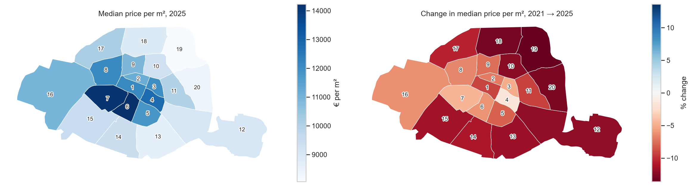
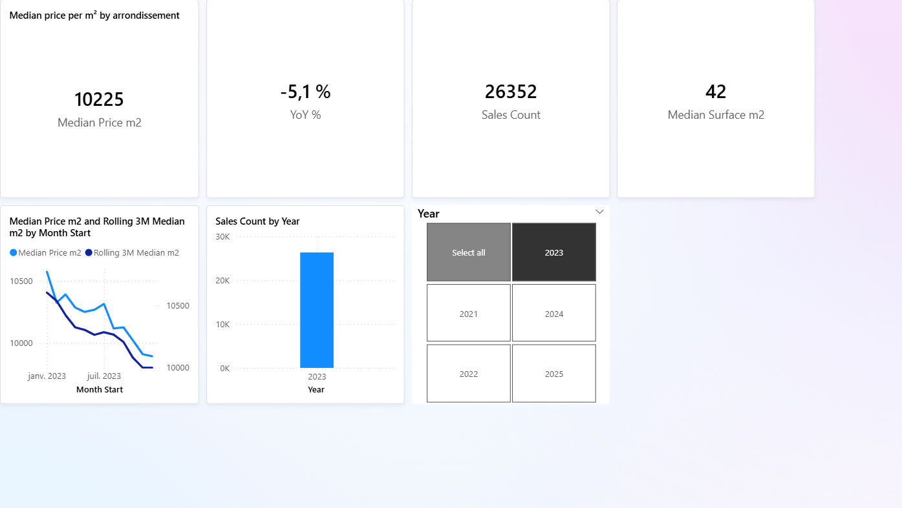
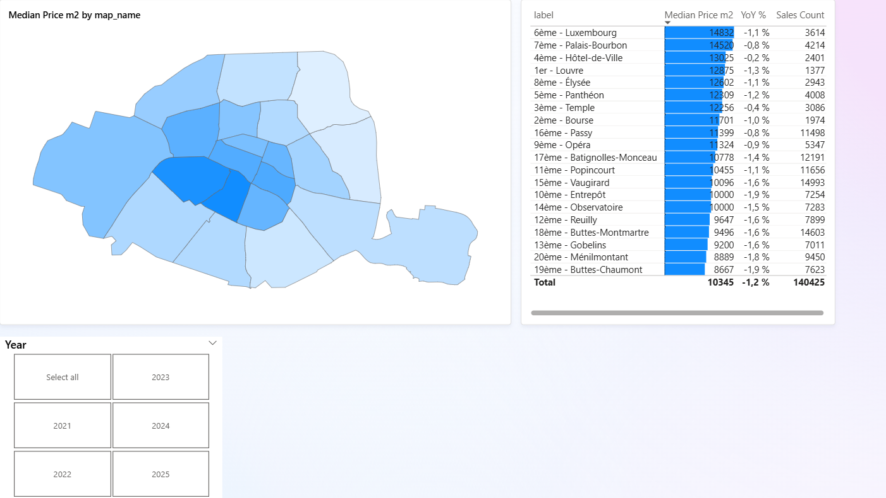
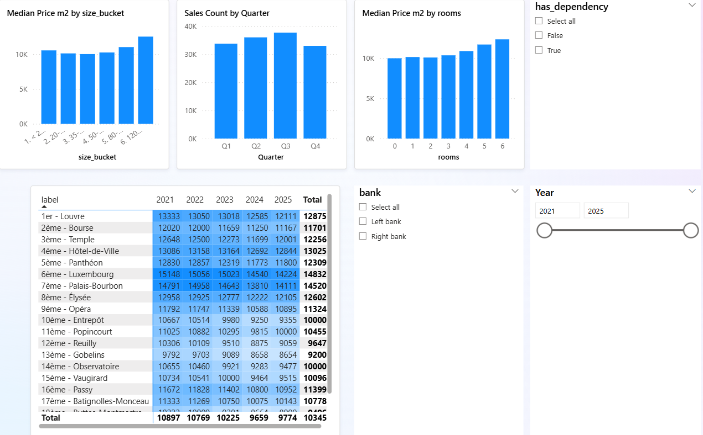
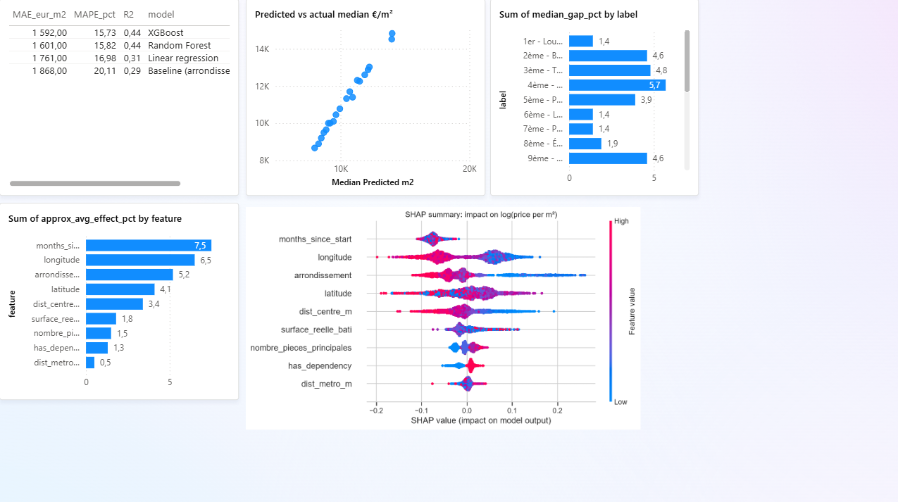
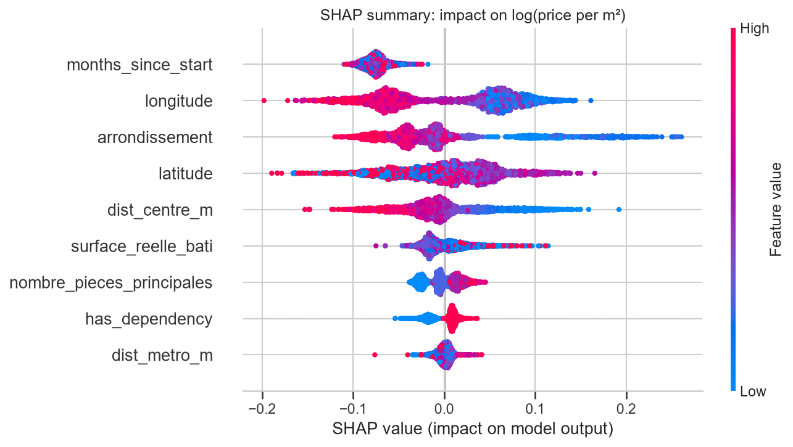

# Paris Real Estate Intelligence

**What drives apartment prices in Paris, how have they moved by arrondissement, and where do they sit against what a model predicts?**
140,425 apartment sales from 5 years (2021–2025) of official French government data, cleaned in SQL, mapped, modelled with XGBoost and explained with SHAP.



## Key findings

1. **Paris prices corrected by 11%, then stabilised.** The median price fell from 10,897 €/m² in 2021 to 9,659 €/m² in 2024, then rose 1.2% in 2025 (9,774 €/m²).
2. **The cheaper north-east fell most, the centre held.** All 20 arrondissements are lower than in 2021, from −1.8% (4th) to −13.6% (19th). The gap between the 6th and the 19th widened from 1.62× to 1.76×.
3. **2024 was the trough.** All 20 arrondissements fell that year, and volume was 26% below 2022. In 2025, volume recovered 16% and 15 of 20 arrondissements rose.
4. **Location drives price, metro access doesn't.** In the XGBoost model, location features (coordinates, arrondissement, distance to centre) move the price by about 19% on average, versus 0.5% for distance to the metro. 90% of sales are within 400 m of a station, so proximity isn't priced.
5. **Price per m² is U-shaped by size.** 35–50 m² flats are cheapest per m²; studios cost 6% more per m² and 120+ m² flats 28% more.

## Dashboard (Power BI)

| Overview | Map |
|---|---|
|  |  |
| **Deep dive** | **Model insights** |
|  |  |

Star schema (fact `Sales`, dimensions `Date` and `Arrondissement`), DAX time intelligence (YoY with `SAMEPERIODLASTYEAR`, rolling 3-month median), Shape Map with a custom TopoJSON. The template is in [`dashboard/paris_real_estate.pbit`](dashboard/), and the build guide in [`dashboard/POWERBI_GUIDE.md`](dashboard/POWERBI_GUIDE.md).

## Price model

Target: log(price per m²). **Time-based split:** trained on 2021–2024 (112,459 sales), tested on the last 12 months (27,796 sales). A random split would let the model learn from sales that happen after the ones it predicts.

| Model | MAE (€/m²) | MAPE | R² |
|---|---:|---:|---:|
| Baseline: arrondissement median | 1,868 | 20.1% | 0.289 |
| Linear regression | 1,761 | 17.0% | 0.307 |
| Random Forest | 1,601 | 15.8% | 0.438 |
| **XGBoost** (tuned with time-series CV) | **1,592** | **15.7%** | **0.438** |

XGBoost cuts the error by 15% compared with the baseline, and predicts 74% of sales within 20% of their real price. R² is capped by what DVF doesn't record: floor, condition, view, energy rating.



SHAP shows location first, a U-shaped effect of surface (studios and large flats cost more per m²), and almost no metro effect. See [`notebooks/04_model_and_shap.ipynb`](notebooks/04_model_and_shap.ipynb) for dependence plots and a waterfall explanation of one apartment.

## Data and cleaning

Source: [Demandes de valeurs foncières géolocalisées](https://www.data.gouv.fr/fr/datasets/demandes-de-valeurs-foncieres-geolocalisees/) (DGFiP / Etalab, Licence Ouverte), département 75, 2021–2025. Arrondissement boundaries: opendata.paris.fr. Stations: Île-de-France Mobilités. Both are under ODbL.

One sale in DVF spans several rows (apartment, cellar, parking), with the **total price repeated on every row**. Cleaning is done in SQL (DuckDB), one rule at a time:

| Step | Sales remaining | Removed | % of start |
|---|---:|---:|---:|
| All sales (distinct `id_mutation`) | 207,365 | | 100.0% |
| Standard sales only (`Vente`) | 204,461 | 2,904 | 98.6% |
| Exactly one apartment (cellar/parking allowed) | 149,673 | 54,788 | 72.2% |
| Price present and > 0 | 149,617 | 56 | 72.2% |
| Surface ≥ 9 m² | 148,640 | 977 | 71.7% |
| Valid arrondissement (1–20) | 148,640 | 0 | 71.7% |
| Price per m² ≥ 3,000 € (non-market transfers) | 143,311 | 5,329 | 69.1% |
| Within 1st–99th percentile of its arrondissement | **140,425** | 2,886 | **67.7%** |

**Limitations**
- DVF has no floor, condition, balcony, view or energy rating (DPE).
- The price includes any cellar or parking sold with the flat (63% of clean sales; flagged as `has_dependency`).
- Sales with several apartments are excluded because their price can't be split.
- Only aggregates are published. The interactive map shows a sample with coordinates blurred by about 100 m, in line with DVF reuse rules.

## Tech stack

Python (pandas, geopandas, shapely, scikit-learn, XGBoost, SHAP, folium, matplotlib, seaborn) · SQL on DuckDB (window functions, `QUANTILE_CONT`, `PIVOT`) · Power BI (DAX, star schema) · Git/GitHub

## Repository structure

```
├── src/
│   ├── download_data.py     # DVF + boundaries + stations, skip-if-exists, logging
│   ├── build_database.py    # runs sql/ in order, exports funnel and agg_* tables
│   ├── features.py          # distance to metro/RER and to centre (Lambert-93)
│   ├── train_model.py       # time split, 4 models, metrics, predictions
│   └── export_powerbi.py    # star-schema CSVs for Power BI
├── sql/
│   ├── 01_staging.sql       # typed raw table
│   ├── 02_clean_sales.sql   # one row per apartment sale + cleaning funnel
│   └── 03_analysis.sql      # 7 business questions (LAG, RANK, window frames, PIVOT…)
├── notebooks/               # 01 exploration · 02 SQL analysis · 03 geo · 04 model & SHAP
├── data/processed/          # aggregated tables (CSV)
├── reports/                 # figures, model metrics, interactive map (paris_map.html)
└── dashboard/               # Power BI template, TopoJSON map, guide, screenshots
```

## How to run

```bash
python -m venv .venv
.venv\Scripts\activate            # macOS/Linux: source .venv/bin/activate
pip install -r requirements.txt

python src/download_data.py       # ~10 MB of raw data into data/raw/
python src/build_database.py      # DuckDB: staging → clean → analysis
python src/features.py            # geo features
python src/train_model.py         # models, metrics, predictions
python src/export_powerbi.py      # tables for Power BI
```

Then open the notebooks in order.

## Next steps

- Add INSEE Filosofi income by IRIS as a socio-economic feature.
- Retrain monthly so the time trend stays current, the model's largest single driver.
- Add DPE energy ratings by joining the ADEME open dataset on address.
- A Streamlit price estimator with a SHAP explanation for each estimate.
